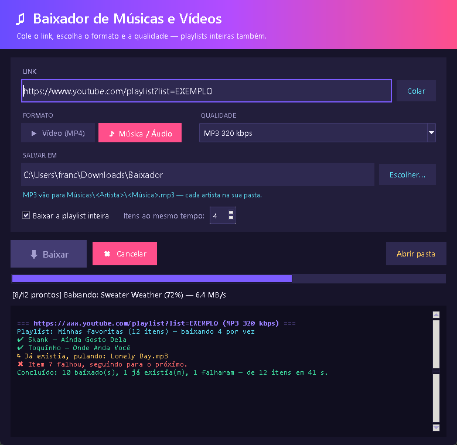
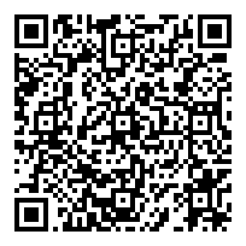

# Baixador de Músicas e Vídeos



Programa simples para Windows: cole um link, escolha **vídeo** ou **música** e a **qualidade**, e clique em **Baixar**.
Se o link for de uma **playlist**, ele baixa todos os itens.

Funciona com YouTube, YouTube Music, SoundCloud, Vimeo, Instagram, TikTok, X/Twitter e
[centenas de outros sites](https://github.com/yt-dlp/yt-dlp/blob/master/supportedsites.md) (usa o [yt-dlp](https://github.com/yt-dlp/yt-dlp) por baixo).
Não funciona com serviços protegidos contra cópia (DRM), como Netflix, Disney+ e o áudio do Spotify/Deezer.

## Links do Spotify

O Spotify não deixa baixar o áudio, mas dá para colar um link de **música, álbum ou playlist**
do Spotify: o programa lê o nome e o artista de cada música, procura no YouTube e baixa de lá,
já organizando em `Músicas\<Artista>\` com os nomes certos do Spotify.

- A playlist precisa ser **pública**.
- O Spotify mostra no máximo **100 músicas por link**; para playlists maiores, divida em partes.
- A busca pega o primeiro resultado do YouTube; em músicas pouco conhecidas pode vir uma versão diferente.

## Lista de erros

No fim de cada download, o registro mostra **quais itens deram erro e por quê**, em português
(vídeo removido, privado, restrição de idade, bloqueado no país, música não encontrada no YouTube…).

## Como usar

1. Baixe o projeto: botão verde **Code → Download ZIP** aqui no GitHub e extraia
   (ou `git clone` este repositório).
2. Dê dois cliques em **`iniciar.bat`**.
   - Na primeira vez ele instala o que falta (Python, yt-dlp e FFmpeg) — demora um pouco.
   - Nas próximas, só atualiza o yt-dlp e abre o programa.
3. Cole o link, escolha formato e qualidade e clique em **Baixar**.

> Dica: extraia numa pasta com caminho curto (ex.: `Área de Trabalho\Baixador`). O Windows
> tem limite de tamanho de caminho e pastas muito profundas podem quebrar a instalação.

## Formatos e qualidades

| Formato | Qualidades |
|---|---|
| Vídeo (MP4) | Melhor disponível, 4K, 2K, 1080p, 720p, 480p, 360p |
| Música / Áudio | MP3 320 / 256 / 192 / 128 kbps, M4A/AAC e OPUS (originais, sem conversão), OGG Vorbis, FLAC, WAV |

FLAC e WAV geram arquivos grandes, mas a qualidade é a mesma da fonte: o YouTube não tem áudio sem perda.
WAV não guarda capa nem fica com a capa embutida; os outros formatos ficam com capa, artista e título.

## Como os arquivos ficam organizados

Dentro da pasta escolhida (por padrão `Downloads\Baixador`; o programa lembra a última):

```
Músicas\
  Artista A\
    Música 1.mp3
    Música 2.mp3
  Artista B\
    Música 3.mp3
Outros formatos\          ← tudo que não é MP3 (M4A, OPUS, OGG, FLAC, WAV), também por artista
  Artista A\
    Música 1.m4a
Vídeos\
  Título do vídeo.mp4
  Nome da playlist\       ← playlists de vídeo, numeradas na ordem
    001 - Primeiro vídeo.mp4
```

- O artista vem dos dados da música (YouTube Music, SoundCloud…), do título no formato
  `Artista - Música` ou, se não tiver, do nome do canal. Partes como "(Official Video)",
  "[Clipe Oficial]" e "(Lyrics)" saem do nome do arquivo; "feat." sai do nome da pasta,
  para o mesmo artista não virar duas pastas.
- MP3/M4A já saem com capa e título/artista embutidos.
- Músicas que já estão na pasta são puladas (não baixa de novo), e o resumo mostra quantas já existiam.
- Se a mesma música aparece mais de uma vez na lista (comum nos "Mix" do YouTube), ela é baixada
  uma vez só e o resumo mostra quantas eram repetidas.

## Velocidade

- Playlists baixam **vários itens ao mesmo tempo** (padrão: 4; dá para mudar de 1 a 8 na tela).
  Num teste com 8 músicas: 39 s um por vez → 12 s com 4 juntos.
- Os arquivos são pedidos em pedaços de 10 MB, o que evita o limite de velocidade que o
  YouTube aplica em downloads longos.
- As informações de cada link são buscadas uma vez só.
- Se a internet ou o computador forem mais fracos, diminua o número de downloads ao mesmo tempo.

## Outros detalhes

- Se o vídeo não tiver a qualidade escolhida, ele pega a maior disponível abaixo dela.
- **Cancelar** para na hora e apaga o arquivo incompleto; o que já terminou continua na pasta.
- Em playlists, se um item falhar (privado, removido), os outros continuam.
- Desmarque "baixar a playlist inteira" para baixar só o vídeo de um link do tipo `watch?v=...&list=...`.

## Problemas comuns

- **Parou de funcionar num site**: os sites mudam com frequência. Feche e abra pelo `iniciar.bat`,
  que atualiza o yt-dlp automaticamente.
- **"FFmpeg não encontrado"**: rode o `iniciar.bat` de novo, ou instale com `winget install Gyan.FFmpeg`.

## Uso responsável

Baixe apenas conteúdo que você tem direito de baixar (seu, de domínio público, licenciado
ou permitido pelo autor) e respeite os termos de uso de cada site.

## ♥ Apoie o projeto

Se o programa te ajudou, considere uma contribuição de qualquer valor — no programa, é o botão
**♥ Apoiar**. Obrigado!

| Pix | ⚡ Bitcoin Lightning |
|:---:|:---:|
|  |  |
| Chave (celular): `+5538988235328` | `pliablemexican29@walletofsatoshi.com` |

Pix copia e cola:

```
00020126540014br.gov.bcb.pix0114+55389882353280214Apoio Baixador5204000053039865802BR5917FRANCISLEY CAMPOS6006BRASIL62070503***63049B81
```

LNURL (Lightning):

```
LNURL1DP68GURN8GHJ7AMPD3KX2AR0VEEKZAR0WD5XJTNRDAKJ7TNHV4KXCTTTDEHHWM30D3H82UNVWQHHQMRFV93XCETDV4UXJCMPDCERJK07WLP
```
